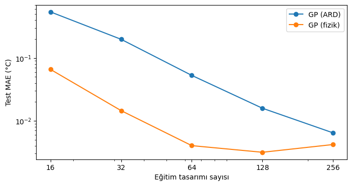

# Surrogate-assisted heat conduction optimization

How accurately can a surrogate predict peak plate temperature, rank design candidates, and screen designs against a temperature threshold?



## Experiment

A sparse finite-difference solver generates steady-state temperature fields on a square plate. The inputs are source position, source strength, thermal conductivity, and boundary temperature. The prediction target is the maximum temperature on the grid. The study uses 256 Sobol training designs and 128 separately sampled test designs.

## Results

| Surrogate | Test MAE (°C) |
|---|---:|
| MLP | 0.132 |
| Polynomial ridge | 0.057 |
| Fixed-kernel Gaussian process | 0.175 |
| Gaussian process with optimized ARD kernel | 0.0064 |
| Physics-guided Gaussian process | **0.0042** |

The physics-guided model predicts the log of the temperature rise and uses the source-strength-to-conductivity ratio as an input. It achieved lower MAE at every measured training budget from 16 to 256. The optimized ARD model also recovered all 20 of the solver's top-ranked designs in a 441-candidate location sweep. That comparison changes several GP settings together, so it cannot isolate the effect of ARD alone. Some GP fits produced convergence warnings. All error measurements use the numerical solver as the reference.

## Run locally

Use Python 3.12. Install the dependencies, open [the notebook](heat_conduction.ipynb) in VS Code or Jupyter, select the environment where you installed them, and run the cells in order.

```bash
python -m pip install -r requirements.txt
```
